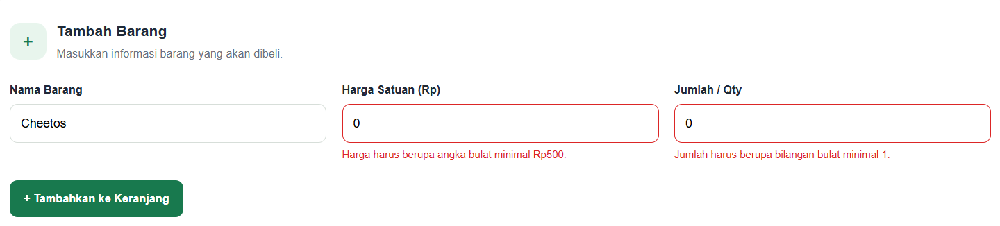
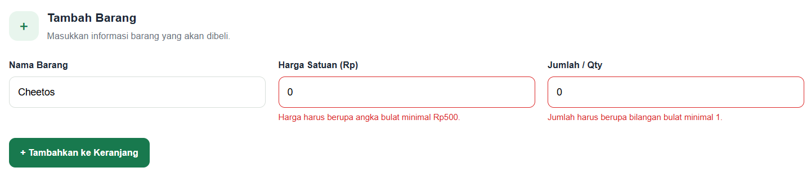
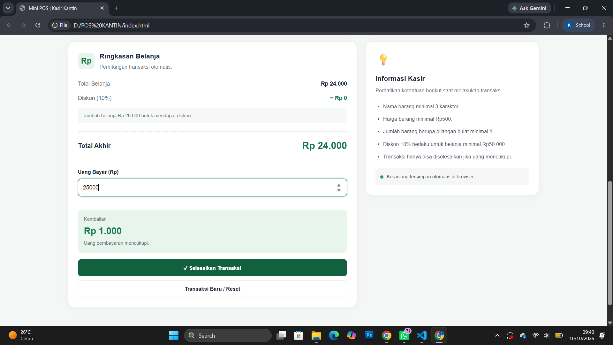
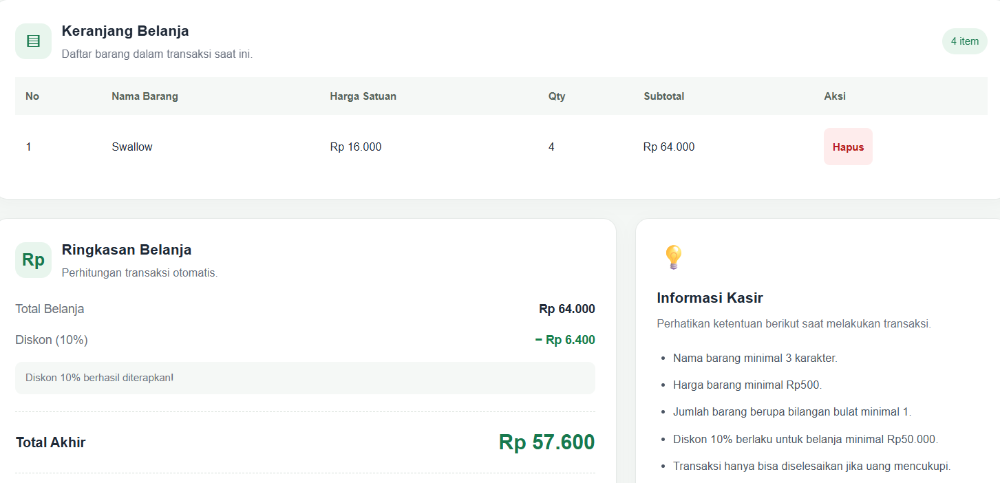

Web Kasir Kantin Kampus

## 1. Identitas Mahasiswa

- Nama              : Angken Muhatun Nufus
- NIM               : 124140065
- Kelas Praktikum   : RA
- Mata Kuliah       : Praktikum Pemrograman Web
- Pertemuan         : 1

## 2. Deskripsi Aplikasi

Mini POS (Point of Sale) merupakan aplikasi kasir sederhana berbasis web yang dirancang untuk membantu proses transaksi pada kantin atau toko kampus.

Aplikasi ini memungkinkan kasir menambahkan barang ke keranjang, menghitung subtotal dan total belanja secara otomatis, memberikan diskon berdasarkan ketentuan tertentu, serta menghitung kembalian dari pembayaran pelanggan.

Tujuan pembuatan aplikasi ini adalah menerapkan validasi input form, logika kalkulasi otomatis menggunakan JavaScript, dan penyimpanan data keranjang menggunakan localStorage.

## 3. Teknologi yang Digunakan

- HTML5 untuk struktur halaman.
- CSS3 untuk desain antarmuka dan responsivitas.
- JavaScript untuk validasi, perhitungan, dan interaksi pengguna.
- localStorage untuk menyimpan data keranjang pada browser.
- JSON.stringify() dan JSON.parse() untuk serialisasi dan pemuatan data.

## 4. Daftar Fitur

- Validasi nama barang minimal 3 karakter.
- Validasi harga satuan minimal Rp500.
- Validasi jumlah barang berupa bilangan bulat minimal 1.
- Pesan kesalahan berwarna merah pada input yang tidak valid.
- Penambahan barang ke keranjang belanja.
- Perhitungan subtotal berdasarkan harga satuan dikali jumlah barang.
- Perhitungan total belanja secara otomatis.
- Diskon 10% untuk total belanja minimal Rp50.000.
- Perhitungan uang pembayaran dan kembalian.
- Informasi kekurangan pembayaran ketika uang belum mencukupi.
- Penghapusan barang dari keranjang.
- Penyimpanan keranjang menggunakan localStorage.
- Pemulihan data keranjang setelah halaman di-refresh.
- Reset transaksi dan penghapusan data keranjang.

## 6. Panduan Menjalankan Aplikasi

1. Unduh atau clone repository proyek dari GitHub.
2. Buka folder proyek menggunakan Visual Studio Code.
3. Pastikan file "index.html", "style.css", dan "script.js" berada dalam satu direktori.
4. Jalankan "index.html" menggunakan ekstensi Live Server atau buka langsung melalui browser.
5. Masukkan nama barang, harga satuan, dan jumlah barang.
6. Tekan tombol Tambahkan ke Keranjang.
7. Periksa tabel belanja, total, diskon, dan pembayaran.
8. Uji fitur hapus barang, refresh halaman, dan reset transaksi.

Aplikasi berjalan di browser dan tidak memerlukan backend maupun database.

## 7. Screenshot Aplikasi

## 8. Penjelasan Teknis

8.1 Validasi Input

Validasi dilakukan menggunakan fungsi "validateForm()" untuk memeriksa nama barang, harga satuan, dan jumlah barang. Jika data tidak memenuhi ketentuan, aplikasi menampilkan pesan kesalahan dan mencegah barang masuk ke keranjang.

8.2 Kalkulasi Otomatis

Subtotal dihitung menggunakan rumus:

"Subtotal = Harga Satuan × Qty"

Total belanja diperoleh dengan menjumlahkan seluruh subtotal barang. Jika total belanja mencapai Rp50.000, aplikasi memberikan diskon sebesar 10%. Total akhir dihitung dengan mengurangi total belanja menggunakan nominal diskon.

Kembalian dihitung dengan rumus:

"Kembalian = Uang Bayar − Total Akhir"

Jika pembayaran kurang dari total akhir, aplikasi menampilkan nominal kekurangan dan tidak mengizinkan transaksi diselesaikan.

8.3 Manajemen Keranjang

Data barang disimpan dalam array JavaScript bernama "cart". Fungsi "renderCart()" menampilkan isi array ke tabel. Fungsi "removeItem()" menghapus barang berdasarkan ID unik, kemudian memperbarui tampilan dan perhitungan.

8.4 Penyimpanan localStorage

Fungsi "saveCart()" menggunakan "JSON.stringify()" untuk mengubah array keranjang menjadi teks dan menyimpannya di browser. Fungsi "loadCart()" menggunakan "JSON.parse()" untuk membaca kembali data saat halaman dibuka.

Fungsi "resetTransaction()" mengosongkan keranjang dan menghapus key penyimpanan keranjang dari localStorage.

## 9. Kesimpulan

Web Mini POS menerapkan konsep dasar pemrograman web melalui validasi form, manipulasi DOM, kalkulasi otomatis, pengelolaan array, serta penyimpanan data pada browser. Aplikasi ini diharapkan dapat menjadi simulasi sederhana sistem kasir untuk kebutuhan kantin atau toko kampus.
